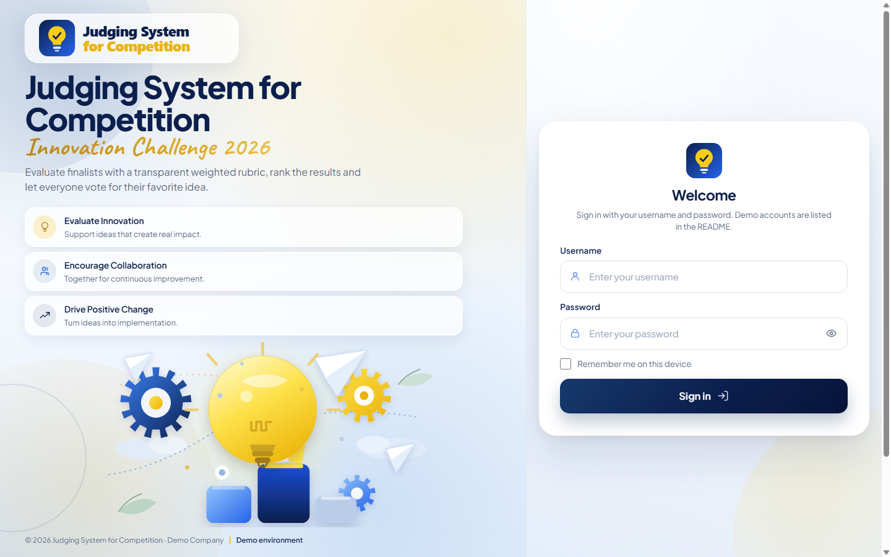
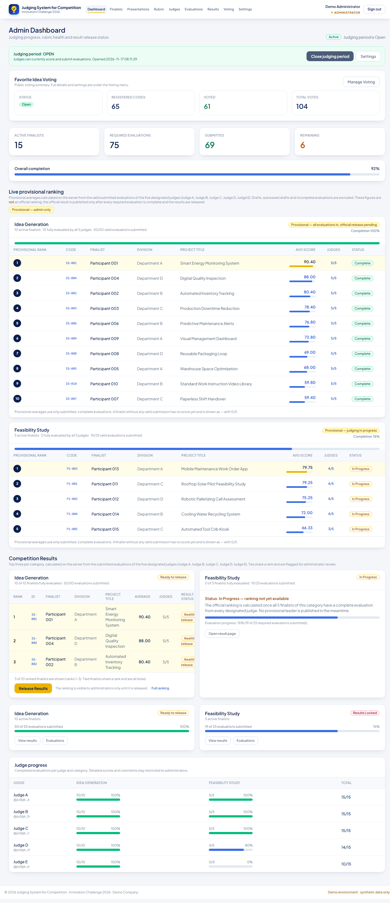
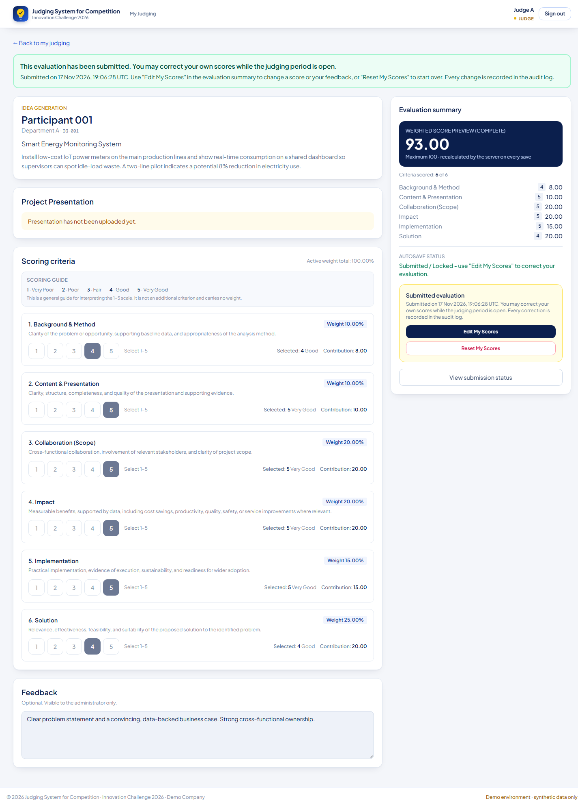
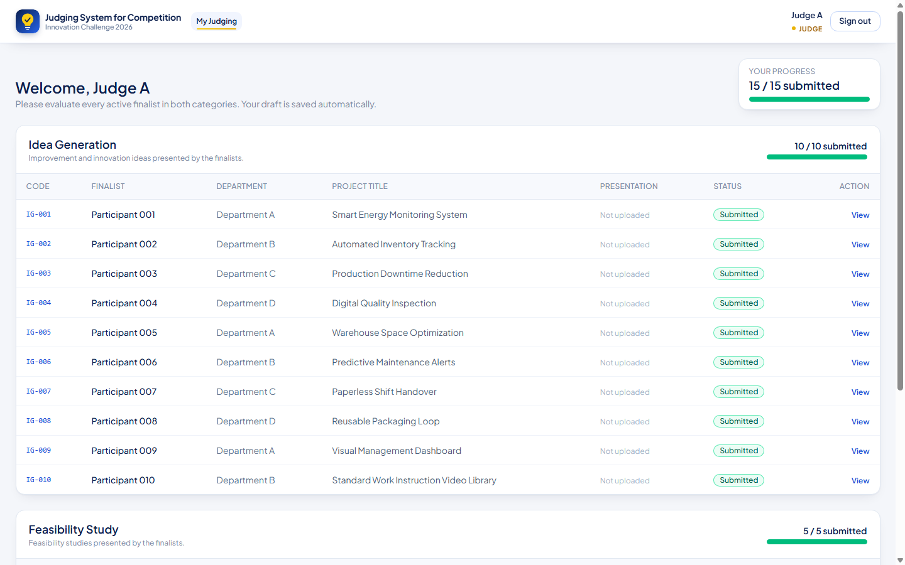
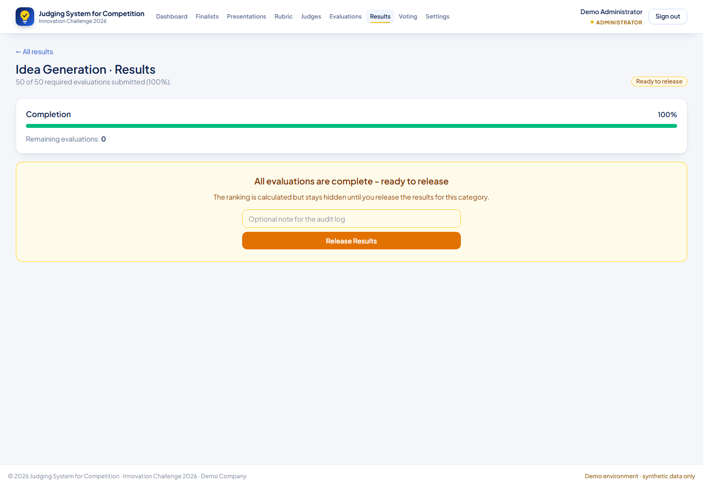
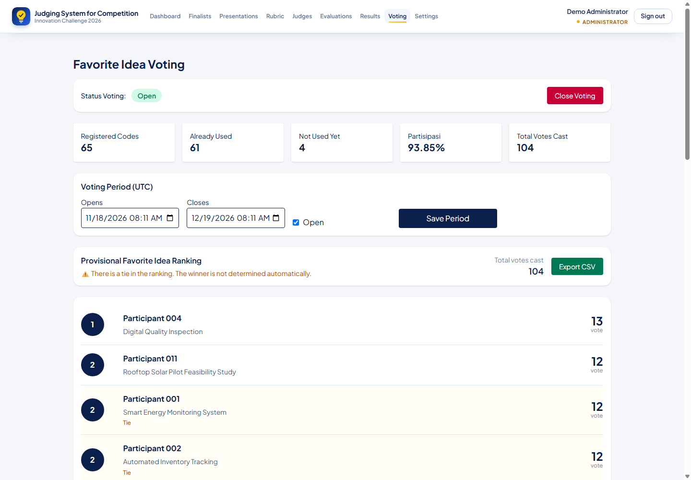

# Judging System for Competition

Judging System for Competition is a Laravel web application for running an internal innovation challenge: administrators curate finalist ideas, judges score them against a weighted rubric, results are ranked and released, and everyone can vote for a **Favorite Idea** with a personal voting code.

> **Demo edition.** This repository ships with 100% synthetic data (fictional judges, participants, ideas, scores and voting codes) for the fictional *Innovation Challenge 2026* of *Demo Company*.

## Screenshots

| Login | Admin dashboard |
|---|---|
|  |  |

| Judge evaluation | Judge dashboard |
|---|---|
|  |  |

| Results | Voting administration |
|---|---|
|  |  |

More: [landing](docs/screenshots/landing.png) · [public voting](docs/screenshots/voting-code.png) · [mobile login](docs/screenshots/login-mobile.png) · [mobile judge dashboard](docs/screenshots/judge-dashboard-mobile.png)

## Features

**Roles & authentication** — username/password login, `admin` and `judge` roles, inactive-account blocking, admin-side judge management and password reset.

**Admin**
- Dashboard: judging progress, per-judge completion, live provisional ranking, result-release status.
- Finalists (ideas): create/edit/deactivate with department, project title and description; optional presentation upload (PDF/PPTX) with protected download.
- Rubric: six weighted criteria per category (weights must total 100%).
- Evaluations: browse, inspect, reopen/reset submitted evaluations.
- Results: competition ranking (ties share a rank and are flagged), top-3 release per category once every required evaluation is complete.
- Settings: open/close the judging period.

**Judge**
- Personal dashboard per category, status tracking (not started / draft / submitted).
- Evaluation screen with 1–5 scoring, live weighted preview, **autosave** drafts, confirmation before submit, and a correction flow.

**Scoring** — `weighted total = Σ (score / 5 × weight)`, expressed out of 100 (range 20–100). Calculated server-side in `App\Services\ScoringService`; the browser preview mirrors it.

**Favorite Idea voting** — public page; each 5-digit voting code can be used once; a ballot has 1–2 votes for *different* ideas; admin sets the voting window, imports codes via CSV, resets codes, finalizes results (top-3 competition winners are excluded), exports CSV; public leaderboard shows the top 3.

> Note: ideas are entered by administrators (there is no participant self-service submission portal).

## Technology stack

PHP 8.2+ · Laravel 12 · MySQL (MariaDB) · Blade templates · Tailwind CSS 4 · Vite 7 · vanilla JavaScript · PHPUnit 11 (SQLite in-memory) · Node DOM tests.

## Installation

Requirements: PHP 8.2+ (with `pdo_mysql`), Composer, Node 18+, MySQL/MariaDB.

```bash
git clone https://github.com/aidrayys/judging-system-for-competition.git
cd judging-system-for-competition

# 1. Create the isolated demo database
mysql -u root -e "CREATE DATABASE judging_demo CHARACTER SET utf8mb4 COLLATE utf8mb4_unicode_ci;"

# 2. Install dependencies
composer install
npm install

# 3. Configure environment
cp .env.example .env
php artisan key:generate        # then adjust DB_USERNAME / DB_PASSWORD in .env if needed

# 4. Migrate and seed the synthetic demo data
php artisan migrate --seed

# 5. Build assets and start the app
npm run build
php artisan serve               # http://127.0.0.1:8000
```

Reset to a pristine demo at any time: `php artisan migrate:fresh --seed`.

## Demo accounts (demo-only, fictional)

| Role | Username | Password |
|---|---|---|
| Administrator | `admin` | `Admin@Demo2026` |
| Judges A–E | `judge_a` … `judge_e` | `Judge@Demo2026` |

Public voting codes to try: **10061, 10062, 10063, 10064, 10065** (unused). Codes 10001–10060 are already used by seeded ballots.

Seeded data: 2 categories, 12 criteria, 15 finalists (Participant 001–015, Departments A–D), 73 evaluations by 5 judges (submitted and in-progress), 65 voting codes and 60 ballots. Judge E deliberately has unfinished work to demonstrate status tracking.

> The admin password defaults to the documented value when `APP_ADMIN_PASSWORD` is empty in `.env`. > These credentials are public placeholders. Never deploy this demo to a public host without changing them.

## Tests

```bash
php artisan test                       # 208 PHPUnit tests (in-memory SQLite, never touches MySQL)
node tests/Support/frontend-scoring.test.mjs   # and the other *.test.mjs DOM tests
```

## Project layout

`app/Services` (scoring, ranking, judging period, audit) · `app/Http/Controllers/{Admin,Judge}` · `database/seeders` (structure + `DemoDataSeeder`) · `resources/views` · `config/ideahub.php` (designated judges, ranking policy).

## License

Provided as a portfolio demonstration. Add the license of your choice before publishing.
